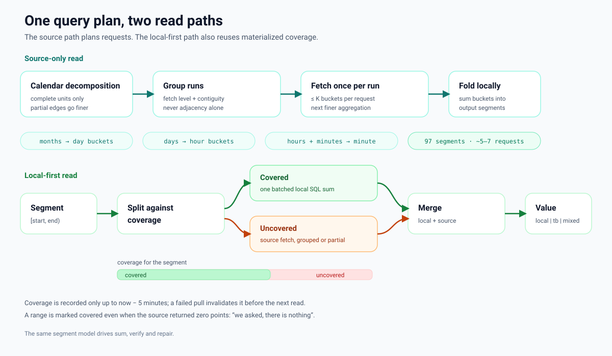

# Architecture

**语言 / Languages:** [English](architecture.md) · [简体中文](architecture.zh-CN.md)



## Layering

```
┌──────────────────────────────────────────────────────────────┐
│  CLI              HTTP API (FastAPI)       MCP server        │
│  hybrid-ladder    /v1/...                  ladder_* tools    │
└───────────────┬──────────────────┬───────────────────────────┘
                │                  │
                ▼                  ▼
┌──────────────────────────────────────────────────────────────┐
│                        LadderEngine                          │
│  decompose · sum · sum_local · sum_mixed                     │
│  materialize · verify · repair · raw chunking                │
└───────────────┬──────────────────────────────┬───────────────┘
                │                              │
                ▼                              ▼
┌───────────────────────────┐    ┌─────────────────────────────┐
│  TimeSeriesSource (read)  │    │  PointStore (read/write)     │
│  interval_agg             │    │  sum_ranges / series         │
│  raw_series               │    │  coverage / delete / upsert  │
└───────────────┬───────────┘    └──────────────┬──────────────┘
                │                               │
        ┌───────┴────────┐              ┌───────┴────────┐
        ▼                ▼              ▼                ▼
  ThingsBoard        Memory          PostgreSQL        Memory
```

The **core** (`core.py`) is pure functions with no I/O and no third-party
dependencies. The **engine** orchestrates source/store calls. The **adapters**
contain all I/O. The **interfaces** (`protocols.py`) are structural: any object
with the right methods works.

## Module map

| Module | Responsibility |
|---|---|
| `core.py` | `unit_start`, `next_boundary`, `decompose`, `fold_sum`, `fold_count`, `merge_coverage`, `split_by_coverage`, `contiguous_runs`, `fetch_runs` |
| `models.py` | `Segment`, `SeriesRef`, `LadderConfig`, `Row`, `QueryResult`, constants |
| `protocols.py` | `TimeSeriesSource`, `PointStore` |
| `engine.py` | Source-only, local-only and mixed reads; materialize; verify; repair; raw chunking; batch concurrency |
| `sources/thingsboard.py` | REST telemetry, auth, 500-bucket chunking, bucket-start normalization |
| `sources/memory.py` | Deterministic in-memory source |
| `stores/postgres.py` | Partitioned readings + coverage tables |
| `stores/memory.py` | In-memory store with coverage |
| `tasks.py` | In-process task registry (progress, cancel, TTL) |
| `api.py` | FastAPI app factory and endpoints |
| `cli.py` | `hybrid-ladder` command line |
| `mcp_server.py` | MCP tools over stdio |
| `runtime.py` | Engine construction from `HL_*` environment variables |
| `demo.py` | Deterministic demo data |

## Core invariants

`decompose` returns a list of `Segment` objects that tile `[start, end)`:

```python
segments[0].start == start
segments[-1].end == end
all(a.end == b.start for a, b in pairwise(segments))
sum(s.end - s.start for s in segments) == end - start
```

`fetch_runs` groups non-tail segments by `FETCH_LEVEL[level]` and contiguity.
This is the fix for the original multi-level bug; see
`docs/algorithm.md §5.1`.

## Source contract

```python
class TimeSeriesSource(Protocol):
    def interval_agg(ref, start_ms, end_ms, bucket_ms, agg="SUM") -> Mapping[int, Any]: ...
    def raw_series(ref, start_ms, end_ms, limit=10_000) -> list[tuple[int, Any]]: ...
```

* `interval_agg` keys are **bucket start** timestamps. Empty buckets are
  omitted. A bucket may have a `None` value (exists but no numeric value).
* `raw_series` returns ascending `(ts, value)` pairs, at most `limit`. If it
  returns exactly `limit`, the engine assumes truncation and bisects the
  window.
* All ranges are `[start, end)`.

### ThingsBoard adapter

| Quirk | Handling |
|---|---|
| ~700 buckets accepted, 800 rejected | `max_intervals=500`, chunked requests |
| Bucket timestamp = start + half bucket | `idx = round((ts - chunk_start - bucket/2) / bucket)` |
| `endTs` inclusive | raw requests use `endTs = end - 1` and filter `ts < end` |
| No `FIRST` aggregation | raw points are used where first values are needed |
| `COUNT` collapses same-minute duplicates | raw points for exact counts |
| JWT expiry | 401 triggers one re-login and retry |

## Store contract

```python
class PointStore(Protocol):
    def sum_ranges(ref, ranges) -> Mapping[int, tuple[float | None, int]]: ...
    def series(ref, start_ms, end_ms, max_points=5_000) -> list[Mapping]: ...
    def coverage(ref) -> list[tuple[int, int, int]]: ...
    def delete_range(ref, start_ms, end_ms) -> int: ...
    def clear_coverage(ref, start_ms, end_ms) -> int: ...
    def upsert_points(ref, points, at_ms=None) -> int: ...
    def mark_covered(ref, start_ms, end_ms, point_cnt, at_ms) -> None: ...
```

`sum_ranges` returns `(None, 0)` for a range with no points and `(0.0, n)` for a
range whose points sum to zero. `series` may paginate internally; `max_points`
is a page size, not a cap on the returned result.

### PostgreSQL schema

With `table_prefix="hl_"` (the default):

```sql
CREATE TABLE hl_readings (
    namespace    text NOT NULL,
    entity       text NOT NULL,   -- stable id (ThingsBoard device id)
    name         text,            -- display name
    key          text NOT NULL,
    ts           bigint NOT NULL,
    value        double precision,
    value_str    text,
    quality      text,
    ingested_at  bigint,
    PRIMARY KEY (namespace, entity, key, ts)
) PARTITION BY RANGE (ts);

CREATE TABLE hl_coverage (
    id          bigserial PRIMARY KEY,
    namespace   text NOT NULL,
    entity      text NOT NULL,
    name        text,
    key         text NOT NULL,
    start_ts    bigint NOT NULL,
    end_ts      bigint NOT NULL,
    point_cnt   bigint,
    covered_at  bigint NOT NULL
);
CREATE INDEX hl_coverage_lookup
    ON hl_coverage (namespace, entity, key, start_ts);
```

Monthly partitions are created on write (`hl_readings_yYYYYmMM`). The primary
key includes `ts`, which is required for a partitioned table and makes upserts
idempotent.

## Mixed read sequence

```
sum_mixed(refs, start, end)
  for each ref (parallel, up to concurrency):
    segments = decompose(start, end)
    coverage = merge_coverage(store.coverage(ref))
    for each segment:
        covered, uncovered = split_by_coverage(segment, coverage)
    local = store.sum_ranges(all covered sub-ranges)      # one SQL
    fill fully uncovered segments from source             # grouped fetch
    for each partially covered segment:
        source_part = sum_range(missing sub-range)        # adaptive bucket
    assemble values and sources
    tb_ranges = merge(all uncovered sub-ranges)
  aggregate grand_total, source_counts
```

## Materialize sequence

```
materialize_ranges(items)
  now = clock()
  claim_end = min(range_end, now - grace)
  for each range:
      store.clear_coverage(range)      # invalidate before rewriting
      store.delete_range(range)
      for chunk in source.raw_series(...):   # bisect on full pages
          store.upsert_points(chunk)
      store.mark_covered(range, written)     # even when written == 0
```

Clearing coverage first is what makes a failed materialize safe: the range is
not marked as trustworthy until the rewrite completes.

## Task registry

Long operations are submitted to `TaskRegistry` (a small `ThreadPoolExecutor`
with a lock-protected dict). A task has `status` (`running`, `completed`,
`failed`, `cancelled`), `done/total`, `message`, `result`, `error`, and
`elapsed`. Results expire after `ttl_sec` (default 1 hour) and the registry is
capped at `max_tasks` (default 100). The registry is in-process; a restart loses
tasks but not data.

The engine's `progress(done, total, message)` and `cancel() -> bool` callbacks
plug directly into the registry.

## HTTP layer

`create_app(engine=..., registry=...)` builds the app. With no arguments it
uses `runtime.engine_from_env()`. Success responses are `{"code": 0, "data":
...}`; errors are `{"code": 1, "detail": ...}`. Long endpoints create a task;
append `?sync=true` for a synchronous response. See `docs/api.md`.

## CLI / MCP

The CLI builds an engine from flags/env and calls the same engine methods. The
MCP server caches one engine built from env and exposes four tools. Neither
layer contains algorithm logic.

## Migration from AutoTestHub

| AutoTestHub | Standalone package |
|---|---|
| `ladder.decompose` | `hybrid_ladder.decompose` / `engine.decompose` |
| `ladder.query_sum(conn, dev_id, key, ...)` | `engine.sum([(entity, key)], ...)` |
| `ladder.query_sum_mixed(conn, conn_id, pairs, ...)` | `engine.sum_mixed(refs, ...)` |
| `ladder.query_sum_local(conn_id, ...)` | `engine.sum_local(refs, ...)` |
| `ladder.materialize_segments` / `materialize_pairs` | `engine.materialize` / `materialize_ranges` |
| `ladder.verify_pairs` | `engine.verify` |
| `resync_service.resync_range` | `engine.repair` |
| `tb_service._tb_get` | `ThingsBoardSource` |
| `pg_store` / `pg_query` | `PostgresStore` |
| `query_task` | `TaskRegistry` |

The standalone PostgreSQL schema uses `namespace/entity/name` instead of
`connection_id/device_id/device`. To read an existing AutoTestHub database,
either migrate the columns or write a thin adapter that maps `namespace` to
`connection_id` and `entity` to `device_id`.

## Adding an adapter

1. Implement the two source methods or the seven store methods.
2. Normalize `interval_agg` keys to bucket starts.
3. Enforce `[start, end)` and sort raw points.
4. Return `(None, 0)` for empty store ranges.
5. Add a test with a deterministic fixture; for HTTP adapters, use
   `httpx.MockTransport`.

## Testing

* `tests/test_core.py` — pure functions, 97-segment example, tiling, coverage
  splitting, fetch grouping regression.
* `tests/test_engine.py` — sums, multi-level regression, empty vs zero, tails,
  batching, cancellation, raw split boundary regression.
* `tests/test_mixed.py` — local-first reads, partial coverage, gaps, grace.
* `tests/test_verify_repair.py` — clean verify, changed/added/removed points,
  drill limits, repair, source deletions.
* `tests/test_api.py`, `test_cli.py`, `test_mcp.py` — entry points.
* `tests/test_thingsboard.py` — bucket normalization, chunking, auth, errors.
* `tests/test_postgres_integration.py` — opt-in with `HL_TEST_PG_DSN`.
