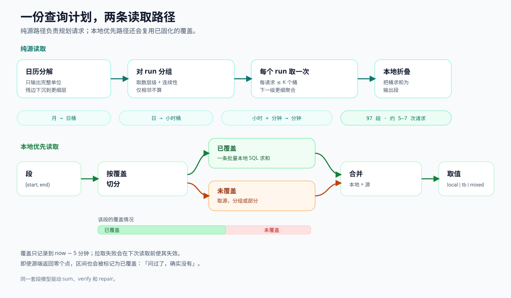

# 架构

**语言 / Languages:** [English](architecture.md) · [简体中文](architecture.zh-CN.md)



## 分层

**核心**（`core.py`）是纯函数，没有 I/O，也没有第三方依赖。**引擎**负责编排
数据源与存储调用。**适配器**包含所有 I/O。**接口**（`protocols.py`）是结构化
的：任何实现了对应方法的对象都可以接入。

```
┌──────────────────────────────────────────────────────────────┐
│  CLI              HTTP API (FastAPI)       MCP server        │
│  hybrid-ladder    /v1/...                  ladder_* tools    │
└───────────────┬──────────────────┬───────────────────────────┘
                │                  │
                ▼                  ▼
┌──────────────────────────────────────────────────────────────┐
│                        LadderEngine                          │
│  decompose · sum · sum_local · sum_mixed                     │
│  materialize · verify · repair · raw chunking                │
└───────────────┬──────────────────────────────┬───────────────┘
                │                              │
                ▼                              ▼
┌───────────────────────────┐    ┌─────────────────────────────┐
│  TimeSeriesSource (read)  │    │  PointStore (read/write)     │
│  interval_agg             │    │  sum_ranges / series         │
│  raw_series               │    │  coverage / delete / upsert  │
└───────────────┬───────────┘    └──────────────┬──────────────┘
                │                               │
        ┌───────┴────────┐              ┌───────┴────────┐
        ▼                ▼              ▼                ▼
  ThingsBoard        Memory          PostgreSQL        Memory
```

## 模块地图

| 模块 | 职责 |
|---|---|
| `core.py` | `unit_start`、`next_boundary`、`decompose`、`fold_sum`、`fold_count`、`merge_coverage`、`split_by_coverage`、`contiguous_runs`、`fetch_runs` |
| `models.py` | `Segment`、`SeriesRef`、`LadderConfig`、`Row`、`QueryResult`、常量 |
| `protocols.py` | `TimeSeriesSource`、`PointStore` |
| `engine.py` | 纯源、纯本地与混合读；固化；校验；修复；原始点分块；批量并发 |
| `sources/thingsboard.py` | REST 遥测、认证、500 桶分块、桶起点归一化 |
| `sources/memory.py` | 确定性的内存数据源 |
| `stores/postgres.py` | 分区 readings 表 + 覆盖表 |
| `stores/memory.py` | 带覆盖记录的内存存储 |
| `tasks.py` | 进程内任务注册表（进度、取消、TTL） |
| `api.py` | FastAPI 应用工厂与端点 |
| `cli.py` | `hybrid-ladder` 命令行 |
| `mcp_server.py` | 基于 stdio 的 MCP 工具 |
| `runtime.py` | 从 `HL_*` 环境变量构建引擎 |
| `demo.py` | 确定性演示数据 |

## 核心不变量

`decompose` 返回一组 `Segment`，它们精确铺满 `[start, end)`：

```python
segments[0].start == start
segments[-1].end == end
all(a.end == b.start for a, b in pairwise(segments))
sum(s.end - s.start for s in segments) == end - start
```

`fetch_runs` 按 `FETCH_LEVEL[level]` 与时间连续性对非零头段分组。这是对原实现
多层级 bug 的修正；见 `docs/algorithm.md §5.1`。

## 数据源契约

```python
class TimeSeriesSource(Protocol):
    def interval_agg(ref, start_ms, end_ms, bucket_ms, agg="SUM") -> Mapping[int, Any]: ...
    def raw_series(ref, start_ms, end_ms, limit=10_000) -> list[tuple[int, Any]]: ...
```

* `interval_agg` 的键是**桶起点**时间戳。空桶不返回。一个桶的值可能是
  `None`（桶存在但没有数值）。
* `raw_series` 返回升序的 `(ts, value)`，最多 `limit` 个。如果正好返回
  `limit` 个，引擎会认为可能被截断并二分窗口。
* 所有区间都是 `[start, end)`。

### ThingsBoard 适配器

| 怪癖 | 处理方式 |
|---|---|
| 约 700 桶可接受，800 被拒 | `max_intervals=500`，分块请求 |
| 桶时间戳 = 起点 + 半桶 | `idx = round((ts - chunk_start - bucket/2) / bucket)` |
| `endTs` 包含端点 | 原始点请求用 `endTs = end - 1` 并过滤 `ts < end` |
| 没有 `FIRST` 聚合 | 需要首值时改用原始点 |
| `COUNT` 会吞同分钟重复点 | 精确点数用原始点 |
| JWT 过期 | 401 触发一次重新登录并重试 |

## 存储契约

```python
class PointStore(Protocol):
    def sum_ranges(ref, ranges) -> Mapping[int, tuple[float | None, int]]: ...
    def series(ref, start_ms, end_ms, max_points=5_000) -> list[Mapping]: ...
    def coverage(ref) -> list[tuple[int, int, int]]: ...
    def delete_range(ref, start_ms, end_ms) -> int: ...
    def clear_coverage(ref, start_ms, end_ms) -> int: ...
    def upsert_points(ref, points, at_ms=None) -> int: ...
    def mark_covered(ref, start_ms, end_ms, point_cnt, at_ms) -> None: ...
```

`sum_ranges` 对无点的区间返回 `(None, 0)`，对有点但求和为 0 的区间返回
`(0.0, n)`。`series` 可以在内部翻页；`max_points` 是页大小，不是返回结果的
上限。

### PostgreSQL 表结构

默认 `table_prefix="hl_"`：

```sql
CREATE TABLE hl_readings (
    namespace    text NOT NULL,
    entity       text NOT NULL,   -- 稳定键（ThingsBoard 设备 id）
    name         text,            -- 展示名
    key          text NOT NULL,
    ts           bigint NOT NULL,
    value        double precision,
    value_str    text,
    quality      text,
    ingested_at  bigint,
    PRIMARY KEY (namespace, entity, key, ts)
) PARTITION BY RANGE (ts);

CREATE TABLE hl_coverage (
    id          bigserial PRIMARY KEY,
    namespace   text NOT NULL,
    entity      text NOT NULL,
    name        text,
    key         text NOT NULL,
    start_ts    bigint NOT NULL,
    end_ts      bigint NOT NULL,
    point_cnt   bigint,
    covered_at  bigint NOT NULL
);
CREATE INDEX hl_coverage_lookup
    ON hl_coverage (namespace, entity, key, start_ts);
```

写入时按需创建月分区（`hl_readings_yYYYYmMM`）。主键包含 `ts`，这是分区表
的要求，也让 upsert 幂等。

## 混合读流程

```
sum_mixed(refs, start, end)
  for each ref（并行，最多 concurrency 个）:
    segments = decompose(start, end)
    coverage = merge_coverage(store.coverage(ref))
    for each segment:
        covered, uncovered = split_by_coverage(segment, coverage)
    local = store.sum_ranges(所有已覆盖子区间)          # 一条 SQL
    完整未覆盖段从数据源取数                            # 分组聚合
    for each 部分覆盖段:
        source_part = sum_range(缺失的子区间)            # 自适应桶长
    组装 value 与 source
    tb_ranges = merge(所有未覆盖子区间)
  汇总 grand_total 与 source_counts
```

## 固化流程

```
materialize_ranges(items)
  now = clock()
  claim_end = min(range_end, now - grace)
  for each range:
      store.clear_coverage(range)      # 重写前先失效
      store.delete_range(range)
      for chunk in source.raw_series(...):   # 满页时二分
          store.upsert_points(chunk)
      store.mark_covered(range, written)     # 即使 written == 0 也登记
```

先清覆盖是固化失败仍然安全的关键：在重写完成之前，该区间不会被标记为可信。

## 任务注册表

长时间操作提交给 `TaskRegistry`（一个小的 `ThreadPoolExecutor` 加锁保护的字
典）。任务有 `status`（`running`、`completed`、`failed`、`cancelled`）、
`done/total`、`message`、`result`、`error` 和 `elapsed`。结果在 `ttl_sec`
（默认 1 小时）后过期，注册表最多保留 `max_tasks`（默认 100）个任务。注册表
在进程内；重启会丢任务，但不会丢数据。

引擎的 `progress(done, total, message)` 与 `cancel() -> bool` 回调可以直接接入
注册表。

## HTTP 层

`create_app(engine=..., registry=...)` 构建应用。不传参数时使用
`runtime.engine_from_env()`。成功响应为 `{"code": 0, "data": ...}`；错误为
`{"code": 1, "detail": ...}`。长端点会创建任务；加 `?sync=true` 同步返回。
见 `docs/api.zh-CN.md`。

## CLI / MCP

CLI 从命令行参数/环境变量构建引擎，并调用相同的引擎方法。MCP 服务器缓存一
个由环境变量构建的引擎，暴露四个工具。两层都不包含算法逻辑。

## 从 AutoTestHub 迁移

| AutoTestHub | 独立包 |
|---|---|
| `ladder.decompose` | `hybrid_ladder.decompose` / `engine.decompose` |
| `ladder.query_sum(conn, dev_id, key, ...)` | `engine.sum([(entity, key)], ...)` |
| `ladder.query_sum_mixed(conn, conn_id, pairs, ...)` | `engine.sum_mixed(refs, ...)` |
| `ladder.query_sum_local(conn_id, ...)` | `engine.sum_local(refs, ...)` |
| `ladder.materialize_segments` / `materialize_pairs` | `engine.materialize` / `materialize_ranges` |
| `ladder.verify_pairs` | `engine.verify` |
| `resync_service.resync_range` | `engine.repair` |
| `tb_service._tb_get` | `ThingsBoardSource` |
| `pg_store` / `pg_query` | `PostgresStore` |
| `query_task` | `TaskRegistry` |

独立包的 PostgreSQL 表结构使用 `namespace/entity/name`，而不是
`connection_id/device_id/device`。如果要读取已有的 AutoTestHub 数据库，可以
迁移列，或写一个薄适配器把 `namespace` 映射到 `connection_id`、把 `entity`
映射到 `device_id`。

## 新增适配器

1. 实现两个数据源方法，或七个存储方法。
2. 把 `interval_agg` 的键归一化为桶起点。
3. 强制 `[start, end)` 并对原始点排序。
4. 空存储区间返回 `(None, 0)`。
5. 加一个确定性 fixture 的测试；HTTP 适配器用 `httpx.MockTransport`。

## 测试

* `tests/test_core.py` — 纯函数、97 段示例、铺满、覆盖切分、取数分组回归。
* `tests/test_engine.py` — 求和、多层级回归、空 vs 零、零头、批量、取消、
  原始点二分边界回归。
* `tests/test_mixed.py` — 本地优先读、部分覆盖、数据缺口、宽限期。
* `tests/test_verify_repair.py` — 干净校验、点变动/新增/缺失、展开上限、
  修复、数据源删除。
* `tests/test_api.py`、`test_cli.py`、`test_mcp.py` — 入口。
* `tests/test_thingsboard.py` — 桶归一化、分块、认证、错误。
* `tests/test_postgres_integration.py` — 通过 `HL_TEST_PG_DSN` 选择启用。
